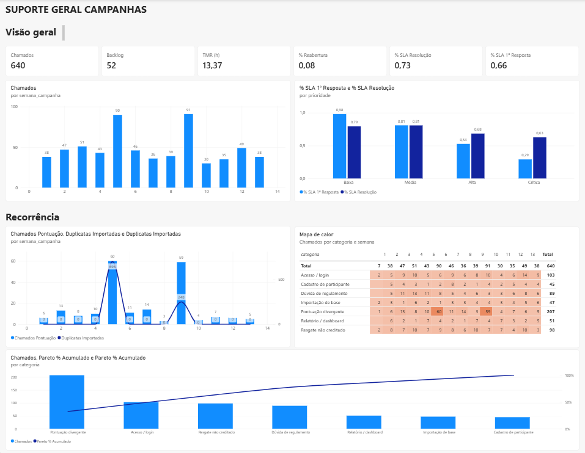

# Suporte & Dados — case prático

> 🎓 Case desenvolvido para a **Pós-graduação em Análise de Dados** da **Anhanguera Educacional** (2026).

> **Pergunta do case:** a fila de suporte de uma campanha de vendas fechou o trimestre com SLA abaixo do esperado. Como está a operação? E por que os chamados de "pontuação divergente" dispararam em semanas específicas?

Este repositório simula o trabalho de um(a) **Analista de Dados** em uma plataforma SaaS que apura campanhas de metas para empresas clientes: medir a fila de suporte, encontrar a causa raiz da recorrência e propor melhoria.

Todos os dados são **fictícios** e gerados por script python (seed fixa), inclusive os erros, que foram inseridos de propósito e com quantidade conhecida.

---

## Painel Power BI



- Arquivo do painel: [`powerbi/painel_suporte_dados.pbix`](powerbi/painel_suporte_dados.pbix) (abra no Power BI Desktop, gratuito)
- Versão em PDF: [`powerbi/painel_suporte_dados.pdf`](powerbi/painel_suporte_dados.pdf)
- Como foi montado: [guia passo a passo](docs/guia_powerbi.md)

## Resultado em 30 segundos

| | |
|---|---|
| **Fila de suporte** | 640 chamados no trimestre (jul–set/2026), 52 ainda em aberto |
| **SLA** | 66,4% de 1ª resposta e 73,3% de resolução dentro do prazo |
| **Ponto de atenção** | chamados **Críticos** têm só 29% de 1ª resposta no prazo, o pior de todas as prioridades |
| **Maior categoria** | "Pontuação divergente": 207 chamados, 1/3 da fila |
| **Causa raiz** | os chamados de pontuação saltam para ~60 nas **semanas 5 e 9**, as mesmas em que 696 e 248 vendas foram importadas em duplicidade |

---

## 1 · Visão geral

Como a fila de suporte se comportou no trimestre.

| Indicador | Valor |
|---|---:|
| Chamados | 640 |
| Backlog (em aberto) | 52 |
| Tempo médio de resolução (TMR) | 13,4 h |
| % Reabertura | 7,8% |
| % SLA de resolução | 73,3% |
| % SLA de 1ª resposta | 66,4% |

**Chamados por semana:** a fila fica entre 30 e 51 chamados por semana, com dois picos fora da curva: **90 na semana 5** e **91 na semana 9**.

**SLA por prioridade:**

| Prioridade | % SLA 1ª resposta | % SLA resolução |
|---|---:|---:|
| Baixa | 98% | 79% |
| Média | 81% | 81% |
| Alta | 53% | 68% |
| Crítica | **29%** | 63% |

O SLA de 1ª resposta **piora conforme a prioridade sobe**, o inverso do desejado: os chamados críticos entram na mesma fila dos demais e demoram a ser percebidos.

## 2 · Recorrência

De onde vêm os picos das semanas 5 e 9.

**Chamados de pontuação × vendas duplicadas por semana.** Os chamados de "Pontuação divergente" ficam entre 3 e 14 por semana, mas sobem para **60 na semana 5** e **59 na semana 9**. São exatamente as semanas em que lotes de vendas foram importados duas vezes:

| Semana | Vendas duplicadas importadas | Chamados de pontuação |
|---:|---:|---:|
| 4 | 0 | 10 |
| **5** | **696** | **60** |
| 6 | 0 | 11 |
| 8 | 0 | 3 |
| **9** | **248** | **59** |
| 10 | 0 | 4 |

**Mapa de calor (categoria × semana):** confirma que o pico é de **uma categoria só**. As demais categorias ficam estáveis o trimestre todo; só "Pontuação divergente" dispara nas semanas 5 e 9.

**Pareto de categorias:**

| Categoria                | Chamados | % acumulado |
| ------------------------ | -------: | ----------: |
| Pontuação divergente     |      207 |       32,3% |
| Acesso / login           |      103 |       48,4% |
| Resgate não creditado    |       98 |       63,8% |
| Dúvida de regulamento    |       89 |       77,7% |
| Relatório / dashboard    |       51 |       85,6% |
| Importação de base       |       47 |       93,0% |
| Cadastro de participante |       45 |      100,0% |

"Pontuação divergente" sozinha é **1/3 da fila**, e 4 das 7 categorias somam cerca de 78% do volume.

## 3 · Conclusão e recomendações

A maior categoria da fila tem **uma causa só**: a reimportação de lotes de vendas. A pontuação do participante sobe com as vendas duplicadas, depois cai na correção, e ele abre chamado.

- **Sistema:** impedir que o mesmo lote seja importado duas vezes (chave única por venda e conferência do arquivo).
- **Processo:** conferir a base antes de publicar a prévia de pontos.
- **Suporte:** resposta padrão com o extrato do participante para "pontuação divergente" e alerta imediato para chamados Críticos.

Análise completa, com 5 porquês e plano de ação: [docs/proposta_melhoria.md](docs/proposta_melhoria.md).

---

## Como foi construído

1. **Dados:** base fictícia de vendas e chamados gerada por script python ([`data/generate_data.py`](data/generate_data.py)).
2. **SQL:** consultas somente leitura que chegam nos mesmos números do painel ([`sql/`](sql/), ver tabela abaixo). A duplicidade, por exemplo, é encontrada com uma função de janela:

```sql
SELECT id_venda, matricula, lote_importacao
FROM (
    SELECT v.*, ROW_NUMBER() OVER w AS rn
    FROM stg_vendas v
    WINDOW w AS (PARTITION BY matricula, data_venda, cod_cliente, cod_produto,
                              quantidade, valor_total ORDER BY id_venda)
)
WHERE rn > 1;   -- 944 vendas duplicadas
```

3. **Power BI:** modelo estrela (tabelas de fatos e dimensões ligadas pelo calendário, prioridade e participante) e medidas DAX para os indicadores do painel: Chamados, Backlog, TMR, % Reabertura, % SLA de resolução, % SLA de 1ª resposta, Chamados de pontuação, Vendas duplicadas e Pareto acumulado. Detalhes em [docs/powerbi_modelo.md](docs/powerbi_modelo.md).

## Mesmo resultado no SQL e no Power BI

Cada visual do painel tem uma consulta SQL equivalente em [`sql/`](sql/). As consultas só leem as tabelas originais (`SELECT`), sem criar ou alterar nada, e chegam exatamente nos mesmos números.

| Visual do painel | Consulta SQL | Resultado |
|---|---|---|
| Cartões da Visão geral | [`01_visao_geral_indicadores.sql`](sql/01_visao_geral_indicadores.sql) | 640 · 52 · 13,4 h · 7,8% · 73,3% · 66,4% |
| Chamados por semana | [`02_chamados_por_semana.sql`](sql/02_chamados_por_semana.sql) | 90 na semana 5 e 91 na semana 9 |
| SLA por prioridade | [`03_sla_por_prioridade.sql`](sql/03_sla_por_prioridade.sql) | Crítica: 29,0% de 1ª resposta no prazo |
| Chamados de pontuação × vendas duplicadas | [`04_recorrencia_pontuacao_x_duplicadas.sql`](sql/04_recorrencia_pontuacao_x_duplicadas.sql) | 60 / 696 na semana 5 · 59 / 248 na semana 9 |
| Mapa de calor | [`05_mapa_calor_categoria_semana.sql`](sql/05_mapa_calor_categoria_semana.sql) | Pontuação divergente: 60 e 59, total 207 |
| Pareto | [`06_pareto_categorias.sql`](sql/06_pareto_categorias.sql) | 32,3% · 48,4% · 63,8% · 77,7% … |

## Como abrir

- **Só ver o painel:** abra o [PDF](powerbi/painel_suporte_dados.pdf) ou o [`.pbix`](powerbi/painel_suporte_dados.pbix) no Power BI Desktop.
- **Explorar os dados no DBeaver ou no HeidiSQL:** abra o banco pronto [`banco/case_suporte.db`](banco/case_suporte.db) e rode qualquer consulta de `sql/`. Passo a passo em [docs/adaptacao_sql.md](docs/adaptacao_sql.md), com adaptação para MySQL, SQL Server e PostgreSQL.
- **Recriar tudo com Python:**

```bash
pip install -r requirements.txt
python data/generate_data.py     # recria a base fictícia (sempre igual)
python src/pipeline.py           # calcula os indicadores e gera powerbi/dados/
```

## Estrutura

```
├── powerbi/
│   ├── painel_suporte_dados.pbix   # painel Power BI
│   ├── painel_suporte_dados.pdf    # painel em PDF
│   └── dados/                      # tabelas do modelo (CSV, padrão pt-BR)
├── banco/case_suporte.db           # banco SQLite para DBeaver / HeidiSQL
├── sql/                            # consultas SQL (somente leitura) que reproduzem o painel
├── data/                           # gerador e base fictícia (CSV)
├── src/                            # pipeline em Python e scripts de preparação (src/sql_preparacao/)
├── reports/img/                    # imagens do README
└── docs/
    ├── proposta_melhoria.md        # causa raiz e plano de ação
    ├── powerbi_modelo.md           # modelo e medidas DAX
    ├── guia_powerbi.md             # passo a passo do painel
    ├── adaptacao_sql.md            # DBeaver, HeidiSQL, MySQL, SQL Server, PostgreSQL
    ├── playbook_triagem.md         # material de apoio: triagem de chamados
    ├── matriz_sla.md               # material de apoio: prazos de SLA
    └── Base_de_Conhecimento/       # material de apoio: artigos BC-001 a BC-003
```

## Limitações

- SLA medido em **horas corridas**; em produção normalmente é em horas úteis.
- Os dados e a empresa são fictícios; a relação entre duplicidade e chamados foi construída para o cenário e serve para demonstrar o método de investigação.

---

**Autora:** Stela — Analista de Processos e Requisitos, formada em Sistemas de Informação (IFG) e pós-graduanda em Análise de Dados pela Anhanguera Educacional. · [LinkedIn](https://www.linkedin.com/in/<seu-perfil>)
