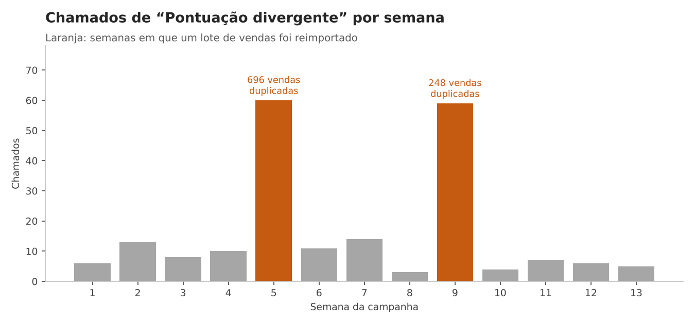
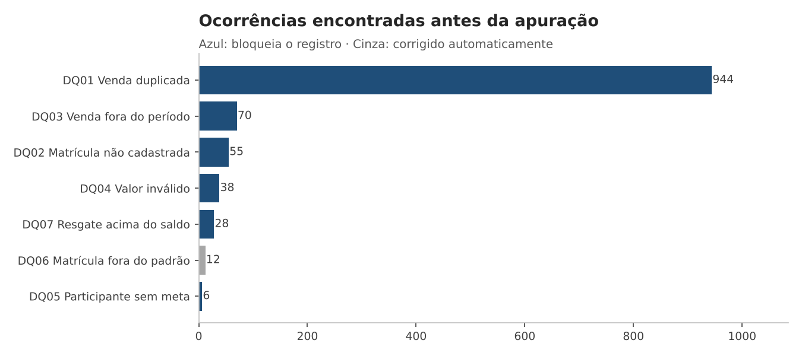
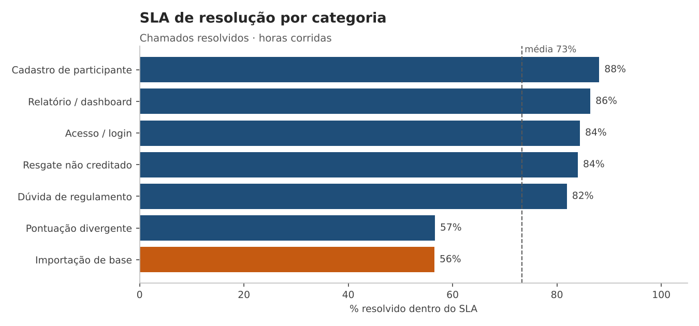

# Suporte & Dados — case prático

> **Pergunta do case:** uma campanha de vendas com metas e premiação fechou o trimestre. Antes de pagar os pontos, dá para confiar na apuração? E por que a fila de suporte estourou o SLA justamente em "pontuação divergente"?

Este repositório simula, de ponta a ponta, o trabalho de um(a) **Analista de Suporte e Dados** em uma plataforma SaaS que apura campanhas de metas para empresas clientes: receber a base do cliente, validar, apurar, conferir, atender os chamados que surgem, medir SLA, achar a causa raiz da recorrência e propor melhoria de processo e de sistema.

Todos os dados são **fictícios** e gerados por script (seed fixa) — inclusive os erros, que foram inseridos de propósito e com quantidade conhecida, para que cada regra de qualidade possa ser conferida contra um gabarito.

---

## Resultado em 30 segundos

| | |
|---|---|
| **Vendas recebidas** | 9.999 linhas, 13 lotes de importação |
| **Vendas aptas à apuração** | 8.892 (1.107 bloqueadas por 4 regras) |
| **Principal problema** | 944 vendas duplicadas por reimportação de lote (R$ 144,9 mil de faturamento inflado) |
| **Impacto evitado** | sem a conferência, **89 participantes** receberiam pontos a mais — **+129 mil pontos (+33%)** sobre os 388 mil corretos; 11 pessoas que não bateram meta pontuariam |
| **Resgates bloqueados** | 28 acima do saldo apurado (9 pedidos anômalos de 25 mil pts + 19 resgates liberados pela prévia inflada) |
| **Fila de suporte** | 640 chamados · 73,3% resolvidos no SLA · "Pontuação divergente" = 32% do volume e só 56,6% no SLA |
| **Causa raiz** | os chamados de pontuação saltam de ~8/semana para ~60 exatamente nas semanas 5 e 9 — as semanas das reimportações |
| **Conferência Excel × SQL** | apuração recalculada com fórmulas no Excel, independente do SQL: **180/180 participantes batem, 0 divergências** |



---

## Competências demonstradas

| Competência | Onde está a evidência |
|---|---|
| Suporte a sistemas e plataformas | [Playbook de triagem](docs/playbook_triagem.md) e [base de conhecimento](docs/Base_de_Conhecimento/) com diagnóstico passo a passo |
| Análise e tratamento de dados (Excel / SQL) | [`sql/02_qualidade_dados.sql`](sql/02_qualidade_dados.sql) · [`reports/apuracao_campanha.xlsx`](reports/apuracao_campanha.xlsx) |
| Relatórios e dashboards (Power BI) | [`reports/indicadores_suporte.xlsx`](reports/indicadores_suporte.xlsx) · [modelo Power BI com medidas DAX](docs/powerbi_modelo.md) · [guia para montar e publicar o painel](docs/guia_powerbi.md) |
| Gestão de chamados com SLA | [`sql/05_chamados_sla.sql`](sql/05_chamados_sla.sql) · [matriz de SLA](docs/matriz_sla.md) |
| Extração, cruzamento e validação de dados | 7 regras de qualidade + cruzamento vendas × metas × resgates × chamados |
| Apoio às áreas de negócio na conferência de resultados | Aba **Apuração** com fórmulas vivas conferindo o SQL linha a linha |
| Documentar e alimentar base de conhecimento | [`docs/Base_de_Conhecimento/`](docs/Base_de_Conhecimento/) — 3 artigos no formato sintoma → causa → solução |
| Identificar recorrência e propor melhoria | [Análise de causa raiz e proposta](docs/proposta_melhoria.md) |
| Comunicação clara | [Comunicado ao cliente](docs/comunicado_cliente.md) explicando a divergência sem jargão |

---

## O cenário

A **Distribuidora Horizonte** (fictícia) roda a campanha **Desafio Trimestral Q3/2026** (01/07 a 30/09) para 180 vendedores e supervisores.

**Regras da campanha**

| Regra | Como funciona |
|---|---|
| Faturamento | atingimento = faturamento válido ÷ meta → <80%: 0 pts · 80–99%: 1.000 · 100–119%: 2.500 · ≥120%: 4.000 |
| Positivação | clientes distintos atendidos ≥ meta de positivação → +1.500 pts |
| Elegibilidade | participante ativo e com meta cadastrada |

As regras ficam em **tabelas de parâmetro** ([`sql/01_parametros.sql`](sql/01_parametros.sql)), não chumbadas na query — a área de Campanhas muda uma faixa sem precisar mexer na apuração.

---

## 1 · Qualidade dos dados antes de apurar

Cada regra grava a ocorrência com o registro e o motivo, o que vira evidência para o chamado e para o cliente.

| Regra | Severidade | Ocorrências | O que significa |
|---|---|---:|---|
| DQ01 Venda duplicada | Bloqueia | 944 | mesma venda importada duas vezes (lotes 05 e 09) |
| DQ02 Matrícula não cadastrada | Bloqueia | 55 | venda de quem não está na campanha |
| DQ03 Venda fora do período | Bloqueia | 70 | junho ou outubro |
| DQ04 Valor inválido | Bloqueia | 38 | zero ou negativo — estorno lançado como venda |
| DQ05 Participante sem meta | Bloqueia | 6 | não dá para apurar: pendência com o cliente |
| DQ06 Matrícula fora do padrão | Alerta | 12 | espaço ou minúscula no cadastro — normalizado e segue |
| DQ07 Resgate acima do saldo | Bloqueia | 28 | prêmio pedido sem lastro de pontos |

Todas as contagens batem com o gabarito de inserção ([`tests/test_pipeline.py`](tests/test_pipeline.py)).



A duplicidade é detectada por janela (`ROW_NUMBER` sobre o conteúdo da venda), mantendo a primeira ocorrência e apontando de qual registro cada duplicata é cópia:

```sql
SELECT 'DQ01 Venda duplicada', 'Bloqueia', 'vendas', id_venda, matricula,
       'Duplicata de ' || id_original || ' no ' || lote_importacao
FROM (
    SELECT v.*, ROW_NUMBER() OVER w AS rn, FIRST_VALUE(id_venda) OVER w AS id_original
    FROM stg_vendas v
    WINDOW w AS (PARTITION BY matricula, data_venda, cod_cliente, cod_produto,
                              quantidade, valor_total ORDER BY id_venda)
)
WHERE rn > 1;
```

## 2 · Apuração e conferência

- **SQL** ([`sql/03_apuracao.sql`](sql/03_apuracao.sql)) apura a partir das vendas válidas e, em paralelo, roda a mesma regra **sem** tratamento para medir o impacto.
- **Excel** ([`reports/apuracao_campanha.xlsx`](reports/apuracao_campanha.xlsx)) refaz o cálculo com fórmulas (`INDEX/MATCH` na tabela de faixas, `IF` no bônus) e compara com o SQL na coluna **Conferência**. Mudou uma faixa na aba Parâmetros, tudo recalcula.

| Faixa | Participantes | Pontos |
|---|---:|---:|
| F0 · abaixo de 80% | 21 | 15.000 |
| F1 · 80% a 99% | 76 | 127.000 |
| F2 · 100% a 119% | 61 | 190.000 |
| F3 · 120% ou mais | 11 | 56.000 |
| **Total (169 elegíveis)** | | **388.000** |

*F0 tem pontos porque o bônus de positivação independe da faixa de faturamento.*

## 3 · Fila de suporte e SLA

640 chamados entre julho e setembro ([`sql/05_chamados_sla.sql`](sql/05_chamados_sla.sql)).

| Indicador | Valor |
|---|---:|
| SLA de 1ª resposta | 66,4% |
| SLA de resolução | 73,3% |
| Tempo médio de resolução | 13,4 h |
| Reabertura | 7,8% |
| Backlog no fim do período | 52 |



Dois achados que não aparecem olhando só a média:

1. **"Pontuação divergente" é 1/3 da fila e a pior em SLA (56,6%) e reabertura (17,4%).** É o chamado que exige cruzar dados para responder — e a resposta "está certo" não convence quando o número no app mudou.
2. **Prioridade Crítica tem só 29% de 1ª resposta no prazo (30 min).** O problema não é resolver — a resolução fica em 62,7% — é *perceber* que o chamado crítico chegou. Isso pede alerta, não mais gente.

## 4 · Causa raiz e proposta

O Pareto mostra 3 categorias somando 64% do volume, mas o cruzamento com os lotes de importação mostra que a maior delas tem **uma causa só**:

| Semana | Duplicatas importadas | Chamados de pontuação |
|---:|---:|---:|
| 4 | 0 | 10 |
| **5** | **696** | **60** |
| 6 | 0 | 11 |
| 8 | 0 | 3 |
| **9** | **248** | **59** |
| 10 | 0 | 4 |

Proposta completa, com 5 porquês, ações de processo e de sistema e estimativa de ganho: **[docs/proposta_melhoria.md](docs/proposta_melhoria.md)**. Em resumo:

- **Sistema:** chave de idempotência por venda + checagem de hash do lote → reimportação não duplica.
- **Processo:** checklist de pré-apuração com as 7 regras; resgate da prévia limitado a um percentual do saldo até a apuração final.
- **Suporte:** artigo de base de conhecimento + macro de resposta para "pontuação divergente" e alerta para chamados Críticos.

---

## Como rodar

```bash
git clone https://github.com/<seu-usuario>/case-suporte-e-dados.git
cd case-suporte-e-dados
pip install -r requirements.txt

python data/generate_data.py     # recria a base fictícia (determinística)
python src/pipeline.py           # carrega, valida, apura, mede SLA e gera reports/ e powerbi/dados/
python -m pytest tests -q        # confere as regras contra o gabarito
```

Usa SQLite (vem com o Python), então não precisa instalar banco. Para SQL Server ou PostgreSQL, veja [docs/adaptacao_sql.md](docs/adaptacao_sql.md).

## Estrutura

```
├── data/
│   ├── generate_data.py        # base fictícia + gabarito das inconsistências
│   └── raw/                    # CSVs: campanha, participantes, metas, produtos, vendas, resgates, chamados
├── sql/
│   ├── 01_parametros.sql       # faixas, bônus, matriz de SLA
│   ├── 02_qualidade_dados.sql  # regras DQ01–DQ06 e vendas válidas
│   ├── 03_apuracao.sql         # apuração + apuração sem tratamento (impacto)
│   ├── 04_resgates.sql         # saldo × resgates (DQ07)
│   ├── 05_chamados_sla.sql     # SLA, backlog, reabertura
│   └── 06_recorrencia.sql      # duplicatas × chamados, Pareto
├── src/
│   ├── pipeline.py             # orquestra tudo e gera os relatórios
│   └── export_powerbi.py       # exporta as tabelas do modelo Power BI
├── powerbi/dados/              # CSVs prontos para importar no Power BI (fatos e dimensões)
├── reports/
│   ├── apuracao_campanha.xlsx  # parâmetros, apuração com fórmulas, qualidade, impacto, resgates
│   ├── indicadores_suporte.xlsx# visão geral, categoria, prioridade, analista, Pareto, recorrência
│   ├── resumo.json             # números do README, gerados pelo pipeline
│   └── img/                    # gráficos
├── docs/
│   ├── playbook_triagem.md     # como receber, classificar e diagnosticar um chamado
│   ├── matriz_sla.md           # prioridades, prazos, escalonamento
│   ├── Base_de_Conhecimento/   # artigos BC-001 a BC-003
│   ├── powerbi_modelo.md       # modelo estrela, medidas DAX e layout do painel
│   ├── guia_powerbi.md         # passo a passo para montar o painel e publicar na web
│   ├── proposta_melhoria.md    # causa raiz e plano de ação
│   ├── comunicado_cliente.md   # retorno ao cliente sobre a divergência
│   └── adaptacao_sql.md
└── tests/test_pipeline.py
```

## Limitações assumidas

- SLA medido em **horas corridas**; em produção normalmente é em horas úteis (ver [matriz de SLA](docs/matriz_sla.md)).
- O painel Power BI é montado a partir de `powerbi/dados/` seguindo o [guia](docs/guia_powerbi.md); a planilha de indicadores permite verificar os números sem licença do Power BI.
- Os dados e a empresa são fictícios; a correlação semanal foi construída para o cenário e serve para demonstrar o método de investigação.

---

**Autora:** Stela — Analista de Processos e Requisitos, formada em Sistemas de Informação (IFG) e pós-graduanda em Análise de Dados. · [LinkedIn](https://www.linkedin.com/in/<seu-perfil>)
